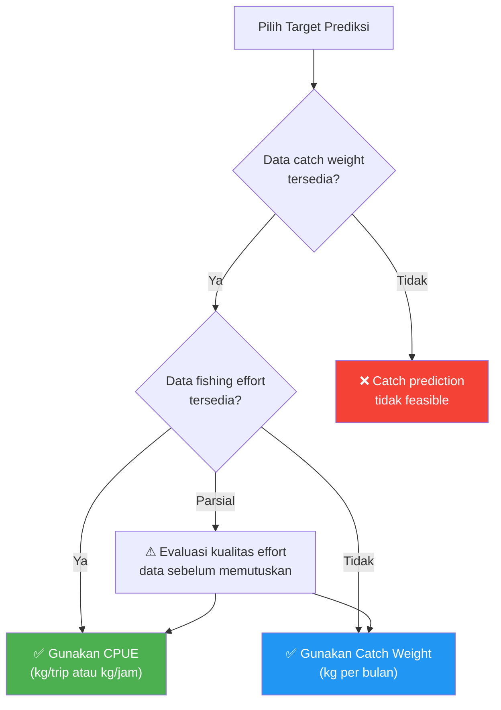
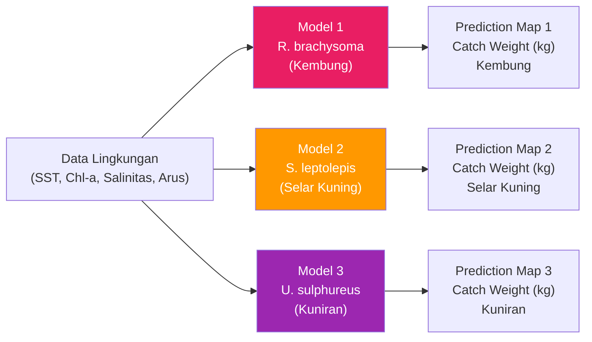

# PREDICTION TARGET DEFINITION — CatchForecast AI

> **Phase:** 1 — Project Definition & Research Foundation  
> **Tanggal:** 18 November 2026

---

## 1. Pendahuluan

Dokumen ini mendefinisikan target prediksi (dependent variable / variabel Y) untuk sistem CatchForecast AI. Pemilihan target prediksi yang tepat merupakan keputusan arsitektural fundamental yang menentukan kebutuhan data, arsitektur model, dan interpretasi output.

---

## 2. Kandidat Target Prediksi

### 2.1 Catch Weight (kg)

| Aspek | Detail |
|---|---|
| **Definisi** | Berat total tangkapan per spesies, dalam satuan kilogram |
| **Unit** | kg per spesies per unit waktu (bulan) per unit spasial (grid/zona) |
| **Sumber data** | Catatan pendaratan ikan di PPI/TPI |
| **Ketersediaan umum** | Relatif tinggi — berat tangkapan umumnya tercatat di PPI/TPI |
| **Keunggulan** | Intuitif; langsung bermakna bagi nelayan dan pengelola perikanan |
| **Kelemahan** | Dipengaruhi oleh fishing effort — tangkapan tinggi bisa karena effort tinggi, bukan kelimpahan |
| **Tipe model** | Regresi |

### 2.2 Catch Count (Jumlah Individu)

| Aspek | Detail |
|---|---|
| **Definisi** | Jumlah individu ikan yang tertangkap per spesies |
| **Unit** | Individu per spesies per unit waktu per unit spasial |
| **Sumber data** | Jarang tercatat secara rutin di PPI/TPI Indonesia |
| **Ketersediaan umum** | Rendah — ikan pelagis kecil biasanya ditimbang, bukan dihitung |
| **Keunggulan** | Lebih bermakna secara ekologis untuk analisis populasi |
| **Kelemahan** | Sangat jarang tersedia; ukuran individu bervariasi |
| **Tipe model** | Regresi (atau Poisson regression untuk count data) |

### 2.3 CPUE (Catch Per Unit Effort)

| Aspek | Detail |
|---|---|
| **Definisi** | Hasil tangkapan per satuan upaya penangkapan |
| **Unit** | kg/trip, kg/jam trawling, kg/unit alat tangkap, dll. |
| **Sumber data** | Memerlukan catatan catch DAN effort secara bersamaan |
| **Ketersediaan umum** | Rendah — fishing effort jarang tercatat secara konsisten |
| **Keunggulan** | Secara ilmiah lebih baik karena menormalisasi effort; lebih mencerminkan kelimpahan relatif |
| **Kelemahan** | Sangat bergantung pada definisi effort; data effort sering tidak tersedia |
| **Tipe model** | Regresi |

---

## 3. Evaluasi Komparatif

| Kriteria | Catch Weight | Catch Count | CPUE |
|---|---|---|---|
| Ketersediaan data | ⭐⭐⭐ | ⭐ | ⭐⭐ |
| Kualitas ilmiah | ⭐⭐ | ⭐⭐ | ⭐⭐⭐ |
| Interpretabilitas | ⭐⭐⭐ | ⭐⭐ | ⭐⭐ |
| Kegunaan praktis | ⭐⭐⭐ | ⭐ | ⭐⭐⭐ |
| Kemudahan implementasi | ⭐⭐⭐ | ⭐⭐ | ⭐⭐ |

---

## 4. Keputusan Target: Catch Weight (kg)

> [!IMPORTANT]
> **Target prediksi utama: Catch Weight (kg) per spesies per bulan.**
> 
> CPUE akan digunakan HANYA JIKA data fishing effort tersedia dan berkualitas memadai. Status ketersediaan effort data masih `OPEN ISSUE`.

### 4.1 Justifikasi

1. **Ketersediaan data**: Catch weight paling umum tercatat di PPI/TPI di Indonesia
2. **Interpretabilitas**: Output "X kg *R. brachysoma* diprediksi pada grid Y di bulan Z" langsung bermakna
3. **Kesederhanaan**: Tidak memerlukan data tambahan (effort) yang mungkin tidak tersedia
4. **Kecukupan untuk proyek**: Untuk konteks tugas mata kuliah, catch weight sudah cukup demonstratif

### 4.2 Kapan CPUE Dapat Digunakan

CPUE dapat menggantikan catch weight sebagai target jika **semua** kondisi berikut terpenuhi:

- [ ] Data fishing effort tercatat secara konsisten (trip, jam, jumlah alat tangkap)
- [ ] Definisi effort konsisten sepanjang periode data
- [ ] Effort dan catch tercatat pada unit spasial dan temporal yang sama
- [ ] Tidak ada perubahan signifikan dalam teknologi/efisiensi penangkapan selama periode data

### 4.3 Kapan CPUE TIDAK Boleh Digunakan

- ❌ Jika fishing effort tidak tercatat
- ❌ Jika definisi effort berubah-ubah (misal: dari "per trip" menjadi "per hari")
- ❌ Jika effort hanya tercatat untuk sebagian kecil data
- ❌ Jika effort tercatat secara agregat (bulanan/tahunan) tanpa detail per trip

---

## 5. Arsitektur Tiga Model Species-Specific

Setiap spesies memiliki model/pipeline prediksi sendiri. Ini bukan satu model multi-output, melainkan tiga model regresi independen.

### 5.1 Alasan Pendekatan Species-Specific

1. **Perbedaan ekologi**: Ketiga spesies menempati niche ekologis berbeda (pelagis kecil vs demersal), sehingga respons terhadap variabel lingkungan berbeda
2. **Feature importance berbeda**: Variabel prediktor yang paling berpengaruh kemungkinan berbeda per spesies
3. **Hyperparameter tuning**: Setiap model dapat di-tune secara independen
4. **Interpretasi lebih jelas**: Output per spesies lebih mudah diinterpretasi dan divalidasi
5. **Ketahanan (robustness)**: Kegagalan satu model tidak memengaruhi model lainnya

### 5.2 Spesifikasi Per Model

| Aspek | Model 1 | Model 2 | Model 3 |
|---|---|---|---|
| **Spesies** | *R. brachysoma* | *S. leptolepis* | *U. sulphureus* |
| **Habitat** | Pelagis kecil, pesisir | Pelagis kecil, pesisir | Demersal, pesisir dangkal |
| **Target Y** | Catch weight (kg/bulan) | Catch weight (kg/bulan) | Catch weight (kg/bulan) |
| **Fitur X** | SST, Chl-a, salinitas, arus, bulan, dll. | SST, Chl-a, salinitas, arus, bulan, dll. | SST, Chl-a, salinitas, arus, bulan, dll. |
| **Algoritma** | XGBoost/LightGBM | XGBoost/LightGBM | XGBoost/LightGBM |
| **Metrik evaluasi** | R², RMSE, MAE | R², RMSE, MAE | R², RMSE, MAE |
| **Output spasial** | Prediction map (grid ~1 km) | Prediction map (grid ~1 km) | Prediction map (grid ~1 km) |

---

## 6. Unit Prediksi

### 6.1 Unit Temporal
- **Resolusi**: Bulanan
- **Format**: Tahun-Bulan (YYYY-MM)
- **Alasan**: Komposit bulanan data satelit mengurangi noise dan cloud gaps; data perikanan dari PPI/TPI umumnya direkapitulasi bulanan

### 6.2 Unit Spasial — MASIH TERBUKA

> [!WARNING]
> Unit spasial prediksi belum dapat ditetapkan final karena tergantung pada format data perikanan yang akan diperoleh.

**Skenario yang mungkin:**

| Skenario | Kondisi | Unit Spasial |
|---|---|---|
| **A: Koordinat tersedia** | Data perikanan mencakup lat/lon penangkapan | Grid reguler ~1 km (0.01°) — catch di-assign ke grid terdekat |
| **B: Zona tersedia** | Data perikanan mencakup nama zona/wilayah penangkapan | Zona/sub-wilayah Teluk Banten — catch per zona |
| **C: Hanya PPI/TPI** | Data perikanan hanya tercatat per lokasi pendaratan (PPI/TPI) | Model non-spasial atau asumsi catchment area per PPI |

**Rekomendasi**: Skenario A ideal. Jika tidak tersedia, gunakan pendekatan grid dengan asumsi distribusi spasial dari model lingkungan. `[STATUS: RECOMMENDATION — perlu validasi data]`

### 6.3 Mekanisme Pembuatan Prediction Map

Terlepas dari skenario unit spasial, prediction map dapat dibuat dengan:

1. Membagi Teluk Banten menjadi grid ~1 km
2. Mengekstrak nilai variabel lingkungan per pixel grid dari data satelit
3. Memasukkan nilai lingkungan ke model terlatih
4. Output model = predicted catch weight per pixel
5. Visualisasi sebagai heatmap/choropleth di Web GIS

> [!NOTE]
> Pada Skenario B dan C, model dilatih pada data catch agregat (per zona/PPI) tetapi prediksi tetap dapat di-generate per pixel grid berdasarkan kondisi lingkungan. Interpretasi spasial harus dilakukan dengan hati-hati dan disertai caveat.

---

## 7. Metrik Evaluasi Model

Metrik berikut akan digunakan untuk mengevaluasi performa setiap model species-specific:

| Metrik | Formula | Interpretasi |
|---|---|---|
| **R² (Coefficient of Determination)** | $R^2 = 1 - \frac{SS_{res}}{SS_{tot}}$ | Proporsi variansi yang dijelaskan model; target ≥ 0.5 |
| **RMSE (Root Mean Square Error)** | $RMSE = \sqrt{\frac{1}{n}\sum(y_i - \hat{y}_i)^2}$ | Error rata-rata dalam satuan kg; makin kecil makin baik |
| **MAE (Mean Absolute Error)** | $MAE = \frac{1}{n}\sum|y_i - \hat{y}_i|$ | Error absolut rata-rata; lebih robust terhadap outlier |
| **MAPE (Mean Absolute Percentage Error)** | $MAPE = \frac{100}{n}\sum\left|\frac{y_i - \hat{y}_i}{y_i}\right|$ | Error persentase; berguna untuk perbandingan antar spesies |

**Validasi**: K-fold cross-validation (k = 5 atau 10) akan digunakan mengingat kemungkinan dataset berukuran kecil. `[STATUS: RECOMMENDATION]`

---

## 8. Open Issues Terkait Target Prediksi

| ID | Issue | Dampak | Resolusi |
|---|---|---|---|
| PT-1 | Unit spasial belum bisa ditetapkan (tergantung format data perikanan) | Tinggi — memengaruhi desain feature engineering | Menunggu akuisisi data di Phase 2 |
| PT-2 | Catch weight mungkin tercatat sebagai total (bukan per spesies) di beberapa PPI | Tinggi — data perlu disagregasi per spesies | Konfirmasi dengan sumber data |
| PT-3 | Apakah model per spesies cukup training data (minimal ~60–120 observasi untuk model tabular) | Sedang — data 5–10 tahun bulanan = 60–120 baris per spesies | Evaluasi setelah data terkumpul |
| PT-4 | Apakah zero-catch (bulan tanpa tangkapan spesies tertentu) tercatat atau hilang dari data | Sedang — memengaruhi distribusi target | Konfirmasi dengan sumber data |

---

*Dokumen ini merupakan bagian dari Phase 1: Project Definition & Research Foundation — CatchForecast AI.*
