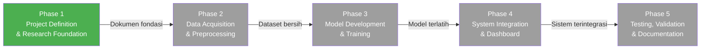

# PROJECT FOUNDATION — CatchForecast AI

> **Phase:** 1 — Project Definition & Research Foundation  
> **Tanggal:** 18 November 2026  
> **Status:** DRAFT — akan difinalisasi setelah seluruh dokumen Phase 1 selesai

---

## 1. Identitas Proyek

| Aspek | Detail |
|---|---|
| **Nama Proyek** | CatchForecast AI |
| **Konteks** | Tugas mata kuliah / proyek akhir semester — ASIK Vol. VI |
| **Tujuan Utama** | Membangun sistem prediksi hasil tangkapan ikan (catch prediction) berbasis AI yang mengintegrasikan data lingkungan laut dan data perikanan di Teluk Banten |
| **Pendekatan** | Species-specific prediction — setiap spesies memiliki model/pipeline sendiri |
| **Jenis Prediksi** | Current prediction — estimasi catch berdasarkan kondisi lingkungan terkini, bukan forecasting masa depan |

---

## 2. Wilayah Studi

| Parameter | Nilai |
|---|---|
| **Lokasi** | Teluk Banten (Banten Bay), Provinsi Banten, Indonesia |
| **Bounding Box** | ~105.9°–106.2° BT, ~5.8°–6.1° LS |
| **Cakupan** | Perairan utara Serang–Cilegon–Tangerang |
| **Karakteristik** | Perairan semi-tertutup, dipengaruhi aktivitas industri, pelabuhan, dan pemukiman pesisir |

> [!NOTE]
> Bounding box bersifat indikatif dan akan divalidasi saat audit data geospasial di Phase 2. Koordinat aktual dapat disesuaikan berdasarkan cakupan data satelit dan data perikanan yang tersedia.

---

## 3. Target Spesies

Tiga spesies ikan yang menjadi target prediksi, dipilih berdasarkan relevansi ekologis dan ekonomis di Teluk Banten:

| No. | Nama Ilmiah | Nama Umum (ID) | Nama Umum (EN) | Famili |
|---|---|---|---|---|
| 1 | *Rastrelliger brachysoma* | Kembung | Short mackerel | Scombridae |
| 2 | *Selaroides leptolepis* | Selar kuning | Yellowstripe scad | Carangidae |
| 3 | *Upeneus sulphureus* | Kuniran | Sulphur goatfish | Mullidae |

**Alasan pemilihan:**
- Ketiga spesies merupakan komponen penting hasil tangkapan perikanan skala kecil (small-scale fisheries) di perairan utara Jawa dan Teluk Banten. `[STATUS: ASSUMPTION — perlu validasi dengan data PPI/TPI lokal]`
- *R. brachysoma* adalah salah satu spesies pelagis kecil dominan di perairan pesisir Indonesia.
- *S. leptolepis* merupakan spesies ekonomis penting dalam perikanan pukat cincin dan jaring insang.
- *U. sulphureus* mewakili spesies demersal yang umum tertangkap di perairan pesisir dangkal.

---

## 4. Keputusan Desain yang Telah Dikunci

Keputusan berikut bersifat **FINAL** dan tidak boleh diubah tanpa justifikasi kuat:

### 4.1 Target Prediksi
| Keputusan | Nilai |
|---|---|
| **Target utama** | Catch weight (kg) per spesies per bulan |
| **Fallback** | Akan dievaluasi berdasarkan ketersediaan data |
| **CPUE** | Tidak dijadikan target final kecuali fishing effort tersedia |

### 4.2 Pendekatan Model
| Keputusan | Nilai |
|---|---|
| **Arsitektur** | Species-specific — satu model per spesies |
| **Algoritma kandidat** | Gradient Boosting (XGBoost / LightGBM) |
| **Jumlah model** | 3 model regresi (satu per spesies) |

### 4.3 Resolusi
| Keputusan | Nilai |
|---|---|
| **Resolusi temporal** | Bulanan (monthly) |
| **Resolusi spasial** | ~1 km (0.01°) |
| **Rentang data historis** | 5–10 tahun (2016–2025/2026) |

### 4.4 Data
| Keputusan | Nilai |
|---|---|
| **Strategi data** | Combined — public/secondary data + institutional/historical fisheries data |
| **Data lingkungan** | Google Earth Engine (GEE) sebagai platform utama |
| **Data perikanan** | Harus diakuisisi dari institusi lokal (DKP, PPI, TPI) |

### 4.5 Teknologi
| Keputusan | Nilai |
|---|---|
| **Geospatial processing** | Google Earth Engine |
| **Data engineering & ML** | Python, scikit-learn, XGBoost/LightGBM |
| **Backend** | FastAPI |
| **Database** | PostgreSQL + PostGIS |
| **Frontend** | React.js |
| **Web GIS** | Leaflet.js |
| **Deployment** | Cloud (GCP/AWS) |

### 4.6 Lainnya
| Keputusan | Nilai |
|---|---|
| **Bahasa dokumentasi & UI** | Bahasa Indonesia |
| **Jenis prediksi** | Current prediction (bukan future forecasting) |

---

## 5. Batasan Phase 1

Phase 1 berfokus **hanya** pada:
- Definisi masalah riset
- Identifikasi target prediksi
- Inventarisasi kebutuhan data
- Perancangan arsitektur sistem
- Pengumpulan referensi ilmiah

**Yang TIDAK dilakukan di Phase 1:**
- ❌ Training model
- ❌ Pembuatan dataset sintetis
- ❌ Pemrosesan GEE
- ❌ Pembangunan website
- ❌ Klaim bahwa data institusional sudah tersedia
- ❌ Prediksi catch tanpa data

---

## 6. Risiko Utama yang Teridentifikasi

| ID | Risiko | Dampak | Mitigasi |
|---|---|---|---|
| R1 | Data perikanan dari institusi lokal tidak tersedia atau sulit diakses | **KRITIS** — model tidak bisa dilatih | Identifikasi multiple sumber data; siapkan proposal permintaan data formal |
| R2 | Data perikanan tidak mencakup koordinat penangkapan | Tinggi — prediksi spasial tidak mungkin | Eksplorasi pendekatan berbasis zona/grid daripada titik |
| R3 | Fishing effort tidak tercatat | Sedang — CPUE tidak bisa dihitung | Gunakan catch weight sebagai target; dokumentasikan limitasi |
| R4 | Resolusi spasial data satelit tidak mencukupi untuk Teluk Banten (area kecil) | Sedang — prediksi kurang detail | Evaluasi produk satelit resolusi tinggi (Sentinel-3) |
| R5 | Cloud masking pada data satelit tinggi (area tropis berawan) | Sedang — data gaps | Gunakan komposit bulanan untuk mengurangi pengaruh awan |

---

## 7. Peta Jalan Fase Proyek (Rencana)

> [!IMPORTANT]
> Fase-fase di atas bersifat indikatif. Urutan dan cakupan dapat berubah berdasarkan ketersediaan data dan kendala teknis.

---

## 8. Glossarium

| Istilah | Definisi |
|---|---|
| **Catch Prediction** | Estimasi jumlah/berat hasil tangkapan ikan berdasarkan variabel lingkungan dan/atau historis |
| **CPUE** | Catch Per Unit Effort — metrik standar yang menormalisasi hasil tangkapan terhadap upaya penangkapan |
| **Current Prediction** | Prediksi berdasarkan kondisi lingkungan terkini yang tersedia, bukan proyeksi masa depan |
| **GEE** | Google Earth Engine — platform cloud computing untuk analisis geospasial |
| **PPI** | Pangkalan Pendaratan Ikan — fasilitas pendaratan ikan |
| **TPI** | Tempat Pelelangan Ikan — tempat pelelangan hasil tangkapan |
| **DKP** | Dinas Kelautan dan Perikanan — instansi pemerintah daerah yang mengelola sektor kelautan dan perikanan |
| **SST** | Sea Surface Temperature — suhu permukaan laut |
| **Chl-a** | Chlorophyll-a — indikator produktivitas primer perairan |
| **Species-specific model** | Model prediksi terpisah untuk setiap spesies target |

---

*Dokumen ini merupakan bagian dari Phase 1: Project Definition & Research Foundation — CatchForecast AI.*
