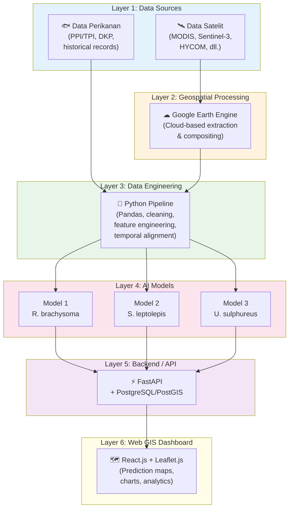
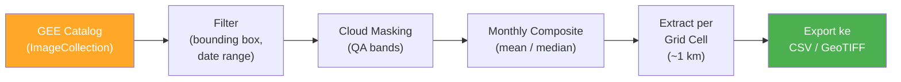
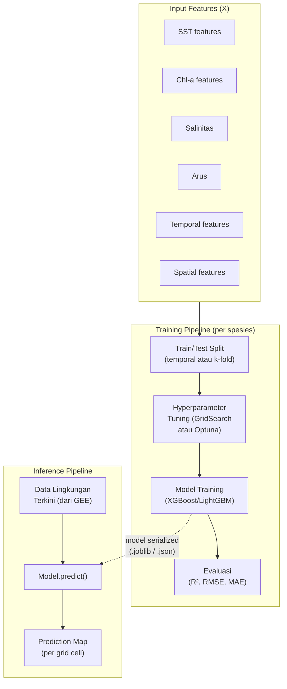
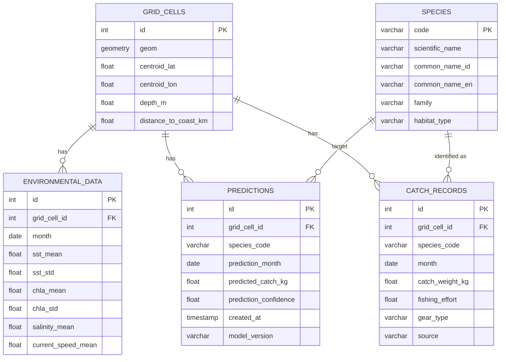
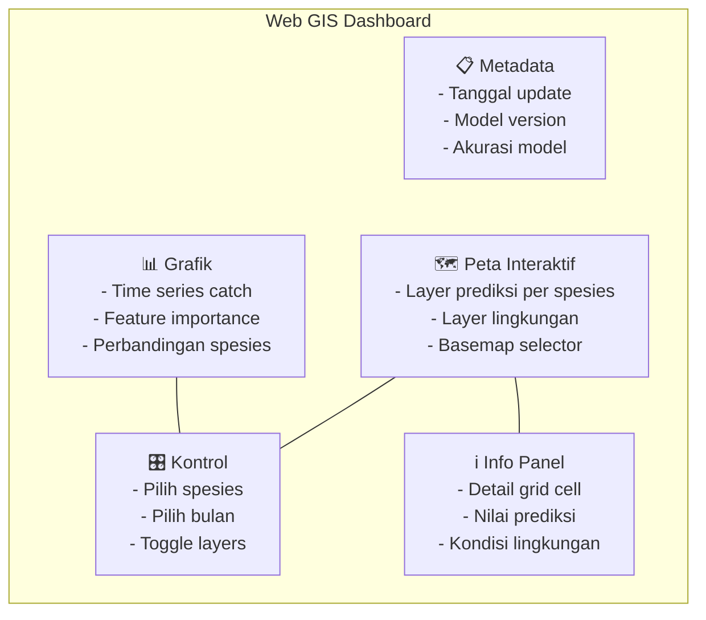
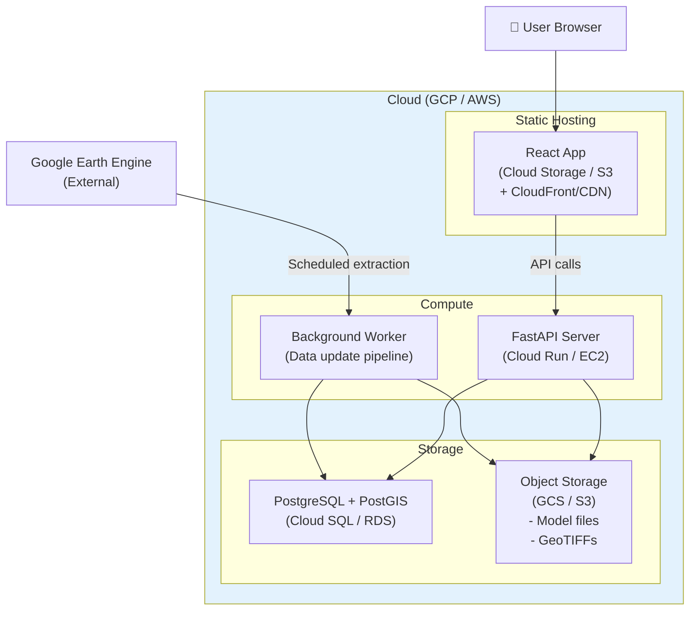
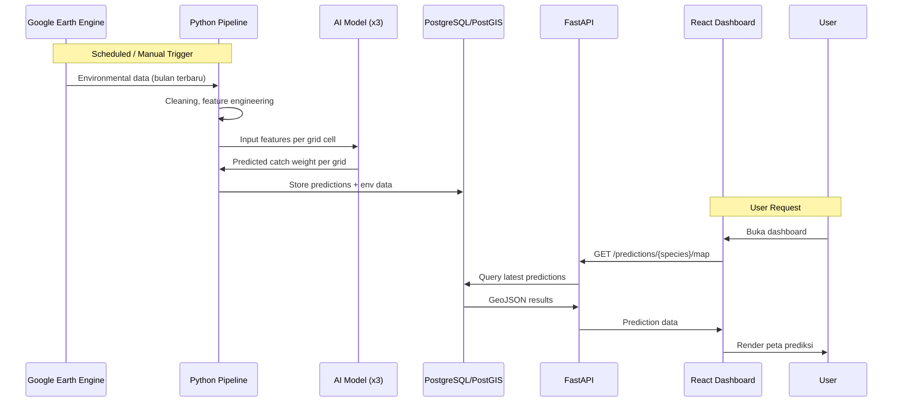

# SYSTEM ARCHITECTURE — CatchForecast AI

> **Phase:** 1 — Project Definition & Research Foundation  
> **Tanggal:** 18 November 2026

---

## 1. Gambaran Umum Arsitektur

Sistem CatchForecast AI dirancang dengan arsitektur berlapis (layered architecture) yang terdiri dari enam lapisan utama. Setiap lapisan memiliki tanggung jawab yang terdefinisi dan berkomunikasi melalui antarmuka (interface) yang jelas.

---

## 2. Layer 1: Data Sources

### 2.1 Data Lingkungan (Satelit / Reanalysis)

| Variabel | Sumber Kandidat | Platform | Resolusi Spasial | Resolusi Temporal | Status |
|---|---|---|---|---|---|
| Sea Surface Temperature (SST) | MODIS Aqua L3 SMI | GEE | ~4 km (global), ~1 km (thermal) | Harian → komposit bulanan | UNVERIFIED — perlu cek GEE catalog |
| Chlorophyll-a (Chl-a) | MODIS Aqua L3 SMI | GEE | ~4 km | Harian → komposit bulanan | UNVERIFIED |
| Salinitas | HYCOM Reanalysis | GEE / Direct | ~8 km (1/12°) | Harian | UNVERIFIED |
| Arus Laut (u, v) | HYCOM Reanalysis | GEE / Direct | ~8 km (1/12°) | Harian | UNVERIFIED |
| Bathymetry | GEBCO / ETOPO | GEE / Direct | ~450 m | Statis | UNVERIFIED |
| Curah Hujan | CHIRPS / GPM | GEE | ~5 km | Harian → bulanan | UNVERIFIED |
| Angin Permukaan | ERA5 Reanalysis | GEE / Direct | ~31 km (0.25°) | Jam-an → bulanan | UNVERIFIED |

> [!NOTE]
> Status "UNVERIFIED" berarti ketersediaan dataset di GEE belum dikonfirmasi untuk wilayah studi. Verifikasi akan dilakukan di Phase 2 melalui audit data.

### 2.2 Data Perikanan (Institusional / Historis)

| Data | Sumber Kandidat | Format Kemungkinan | Status |
|---|---|---|---|
| Catch weight per spesies | PPI/TPI di sekitar Teluk Banten | Spreadsheet / buku catatan / PDF | BELUM TERSEDIA |
| Fishing effort | PPI/TPI / logbook nelayan | Spreadsheet / tidak tercatat | BELUM TERSEDIA |
| Lokasi penangkapan | PPI/TPI / nelayan | Koordinat / nama wilayah / tidak tercatat | BELUM TERSEDIA |
| Jenis alat tangkap | PPI/TPI / DKP Banten | Tercatat sebagai kategori | BELUM TERSEDIA |
| Identifikasi spesies | PPI/TPI | Nama lokal → perlu mapping ke nama ilmiah | BELUM TERSEDIA |
| Statistik perikanan kabupaten/kota | DKP Kabupaten/Kota / BPS | Publikasi tahunan (PDF/web) | BELUM TERSEDIA |

> [!WARNING]
> Seluruh data perikanan berstatus BELUM TERSEDIA. Akuisisi data perikanan adalah prasyarat kritis (critical path) untuk keberhasilan proyek. Tanpa data ini, model catch prediction tidak dapat dilatih.

---

## 3. Layer 2: Google Earth Engine (Geospatial Processing)

### 3.1 Fungsi Utama

GEE berperan sebagai platform utama untuk:
1. **Akses data satelit**: Langsung dari katalog GEE tanpa download manual
2. **Cloud masking**: Menghilangkan piksel berawan dari citra satelit
3. **Compositing**: Membuat komposit bulanan dari citra harian/8-harian
4. **Spatial extraction**: Mengekstrak nilai variabel lingkungan per grid cell
5. **Export**: Mengekspor data ke format tabular (CSV) atau raster (GeoTIFF) untuk proses lanjut

### 3.2 Workflow GEE (Rencana)

### 3.3 Pertimbangan Teknis

- **Akun GEE**: Diperlukan akun GEE for Education / Research (gratis)
- **Bahasa**: JavaScript (Code Editor) atau Python (Earth Engine Python API via `ee`)
- **Quota**: GEE memiliki komputasi gratis yang umumnya cukup untuk proyek ini
- **Nearshore artifacts**: Data satelit oseanografi sering memiliki artefak di dekat pantai; perlu masking daratan (land mask) `[STATUS: RECOMMENDATION]`

---

## 4. Layer 3: Python Data Engineering

### 4.1 Fungsi Utama

Pipeline Python menangani:
1. **Data cleaning**: Penanganan missing values, outlier, dan inkonsistensi
2. **Data integration**: Menggabungkan data lingkungan (dari GEE) dengan data perikanan (dari institusi)
3. **Feature engineering**: Pembuatan fitur tambahan (lag temporal, indeks, transformasi)
4. **Temporal alignment**: Memastikan data lingkungan dan data catch selaras secara temporal
5. **Spatial matching**: Matching koordinat catch dengan grid lingkungan
6. **Train/test split**: Pembagian dataset untuk training dan evaluasi

### 4.2 Library Python

| Library | Fungsi | Versi Minimum |
|---|---|---|
| `pandas` | Manipulasi data tabular | 1.5+ |
| `numpy` | Komputasi numerik | 1.24+ |
| `geopandas` | Data geospasial (vector) | 0.12+ |
| `rasterio` | Data raster (GeoTIFF) | 1.3+ |
| `xarray` | Data multidimensi (NetCDF) | 2023+ |
| `scikit-learn` | Preprocessing, model selection, metrics | 1.2+ |
| `xgboost` | Gradient boosting | 1.7+ |
| `lightgbm` | Gradient boosting (alternatif) | 3.3+ |
| `matplotlib` / `seaborn` | Visualisasi | - |
| `earthengine-api` (`ee`) | Akses GEE dari Python | 0.1.370+ |

### 4.3 Feature Engineering Plan

| Fitur | Sumber | Tipe | Catatan |
|---|---|---|---|
| SST (mean, min, max, std) | MODIS via GEE | Numerik kontinu | Per grid cell, bulanan |
| Chl-a (mean, min, max, std) | MODIS via GEE | Numerik kontinu | Per grid cell, bulanan |
| Salinitas (mean) | HYCOM | Numerik kontinu | Per grid cell, bulanan |
| Kecepatan arus (mean, max) | HYCOM | Numerik kontinu | Dihitung dari u, v |
| Arah arus dominan | HYCOM | Numerik (derajat) / kategorikal | Dihitung dari u, v |
| Kedalaman (bathymetry) | GEBCO | Numerik kontinu | Statis per grid cell |
| Bulan | Kalender | Kategorikal / numerik | Encoded: sin/cos transform |
| Musim | Kalender + klimatologi | Kategorikal | Barat (Des-Feb), Peralihan I (Mar-Mei), Timur (Jun-Agu), Peralihan II (Sep-Nov) |
| Anomali SST | Dihitung | Numerik kontinu | Deviasi dari rata-rata klimatologis |
| Anomali Chl-a | Dihitung | Numerik kontinu | Deviasi dari rata-rata klimatologis |
| Jarak ke pantai | Dihitung dari garis pantai | Numerik kontinu | Statis per grid cell |
| SST bulan sebelumnya (lag-1) | MODIS | Numerik kontinu | Efek lag temporal |
| Chl-a bulan sebelumnya (lag-1) | MODIS | Numerik kontinu | Efek lag temporal |

> [!TIP]
> Fitur lag temporal (1–2 bulan sebelumnya) penting karena respons biologis terhadap perubahan lingkungan tidak instan. Produktivitas primer (Chl-a) bulan ini mungkin baru memengaruhi catch bulan berikutnya.

---

## 5. Layer 4: AI Models (Species-Specific)

### 5.1 Arsitektur Model

### 5.2 Training Strategy

| Aspek | Rencana |
|---|---|
| **Algoritma utama** | XGBoost (`xgboost.XGBRegressor`) |
| **Algoritma pembanding** | LightGBM, Random Forest (sebagai baseline) |
| **Validation** | K-fold cross-validation (k = 5) atau temporal split |
| **Hyperparameter tuning** | Grid search atau Bayesian optimization (Optuna) |
| **Feature selection** | Berbasis feature importance dari model, atau recursive feature elimination |
| **Handling small dataset** | Regularisasi, early stopping, cross-validation |

### 5.3 Model Serialization

Model terlatih disimpan dalam format serialized untuk digunakan di backend:
- Format utama: `.joblib` (scikit-learn compatible) atau XGBoost native `.json`
- Metadata model (hyperparameter, metrics, training date) disimpan bersama
- Versioning model untuk tracking

---

## 6. Layer 5: Backend / API

### 6.1 Teknologi

| Komponen | Teknologi | Alasan |
|---|---|---|
| **Framework** | FastAPI (Python) | Async, cepat, auto-generate OpenAPI docs |
| **Database** | PostgreSQL + PostGIS | Mendukung query spasial; mature dan stabil |
| **ORM** | SQLAlchemy + GeoAlchemy2 | Interaksi database dengan dukungan geospasial |
| **Serialization** | Pydantic (built-in FastAPI) | Validasi data otomatis |

### 6.2 API Endpoints (Rencana)

| Endpoint | Method | Fungsi |
|---|---|---|
| `/api/v1/predictions/{species}` | GET | Mendapatkan prediksi catch terkini untuk spesies tertentu |
| `/api/v1/predictions/{species}/map` | GET | Mendapatkan data GeoJSON prediksi spasial |
| `/api/v1/predictions/{species}/history` | GET | Riwayat prediksi |
| `/api/v1/environment/current` | GET | Kondisi lingkungan terkini |
| `/api/v1/environment/history` | GET | Riwayat data lingkungan |
| `/api/v1/species` | GET | Daftar spesies target |
| `/api/v1/metadata` | GET | Metadata sistem (last update, model version, dll.) |

### 6.3 Database Schema (Rencana Awal)

---

## 7. Layer 6: Web GIS Dashboard

### 7.1 Teknologi

| Komponen | Teknologi | Alasan |
|---|---|---|
| **Frontend framework** | React.js | Ekosistem besar, component-based |
| **Map library** | Leaflet.js (via react-leaflet) | Ringan, mature, banyak plugin |
| **State management** | React Context / Zustand | Ringan untuk skala proyek ini |
| **Charts** | Recharts / Chart.js | Integrasi mudah dengan React |
| **HTTP client** | Axios / Fetch API | Komunikasi dengan backend |
| **Styling** | Tailwind CSS / CSS Modules | Utility-first, cepat development |

### 7.2 Fitur Dashboard (Rencana)

### 7.3 Komponen Peta

| Layer | Tipe | Data |
|---|---|---|
| Prediction heatmap | Raster/Grid overlay | Catch weight (kg) per grid cell |
| SST overlay | Raster overlay | SST bulanan (°C) |
| Chl-a overlay | Raster overlay | Chlorophyll-a bulanan (mg/m³) |
| Study area boundary | Polygon | Bounding box / area outline |
| Grid cells | Polygon grid | Grid ~1 km |
| Basemap | Tile layer | OpenStreetMap / ESRI World Imagery |

---

## 8. Deployment Architecture

> [!NOTE]
> Arsitektur deployment di atas adalah rencana awal. Detail implementasi (pilihan GCP vs AWS, tier/instance size, estimasi biaya) akan dievaluasi di Phase 4. Untuk development dan demo, sistem bisa dijalankan sepenuhnya di localhost.

---

## 9. Data Flow: Current Prediction

Berikut adalah alur data dari sumber hingga tampilan prediksi:

---

## 10. Evaluasi Teknologi

### 10.1 Teknologi yang Diadopsi (dengan Alasan)

| Teknologi | Alasan Adopsi |
|---|---|
| **Google Earth Engine** | Satu-satunya platform yang menyediakan akses gratis ke katalog satelit besar dengan processing di cloud; menghindari download data TB-sized |
| **Python** | Lingua franca untuk data science dan ML; ekosistem library paling lengkap |
| **XGBoost/LightGBM** | Performa state-of-the-art untuk data tabular; interpretable via feature importance |
| **FastAPI** | Python-native (konsisten dengan ML stack); async; auto-docs |
| **PostgreSQL + PostGIS** | Database relasional paling mature dengan dukungan geospasial terbaik |
| **React.js** | Ekosistem terbesar; `react-leaflet` untuk integrasi peta |
| **Leaflet.js** | Ringan (~42 KB gzipped); dokumentasi sangat baik; cocok untuk peta tematik |

### 10.2 Alternatif yang Dipertimbangkan dan Ditolak

| Alternatif | Alasan Ditolak |
|---|---|
| **MapLibre GL JS** | Lebih cocok untuk vector tiles kompleks; overkill untuk proyek ini |
| **OpenLayers** | Terlalu kompleks; learning curve tinggi |
| **Django** | Monolitik; FastAPI lebih ringan dan modern untuk API-first architecture |
| **Flask** | Kurang fitur dibanding FastAPI (no async, no auto-validation) |
| **Deep Learning (LSTM, CNN)** | Membutuhkan data jauh lebih besar dari yang diperkirakan tersedia (~60–120 observasi per spesies) |
| **MongoDB** | NoSQL kurang cocok untuk data spasial terstruktur; PostGIS lebih powerful untuk spatial queries |
| **Streamlit** | Bagus untuk prototyping tapi kurang fleksibel untuk custom GIS dashboard |
| **Vue.js** | Ekosistem GIS plugin lebih kecil dibanding React |

---

## 11. Open Issues Arsitektur

| ID | Issue | Status | Dampak |
|---|---|---|---|
| SA-1 | Pilihan cloud provider (GCP vs AWS) belum diputuskan | OPEN | Memengaruhi deployment pipeline |
| SA-2 | Frekuensi update prediksi (bulanan manual vs otomatis) | OPEN | Memengaruhi desain worker/scheduler |
| SA-3 | Autentikasi dashboard (publik vs restricted) | OPEN | Memengaruhi desain API security |
| SA-4 | Strategi caching untuk peta prediksi | OPEN | Memengaruhi performa dashboard |
| SA-5 | Volume data yang akan disimpan (estimasi) | OPEN | Memengaruhi pilihan tier database |

---

*Dokumen ini merupakan bagian dari Phase 1: Project Definition & Research Foundation — CatchForecast AI.*
