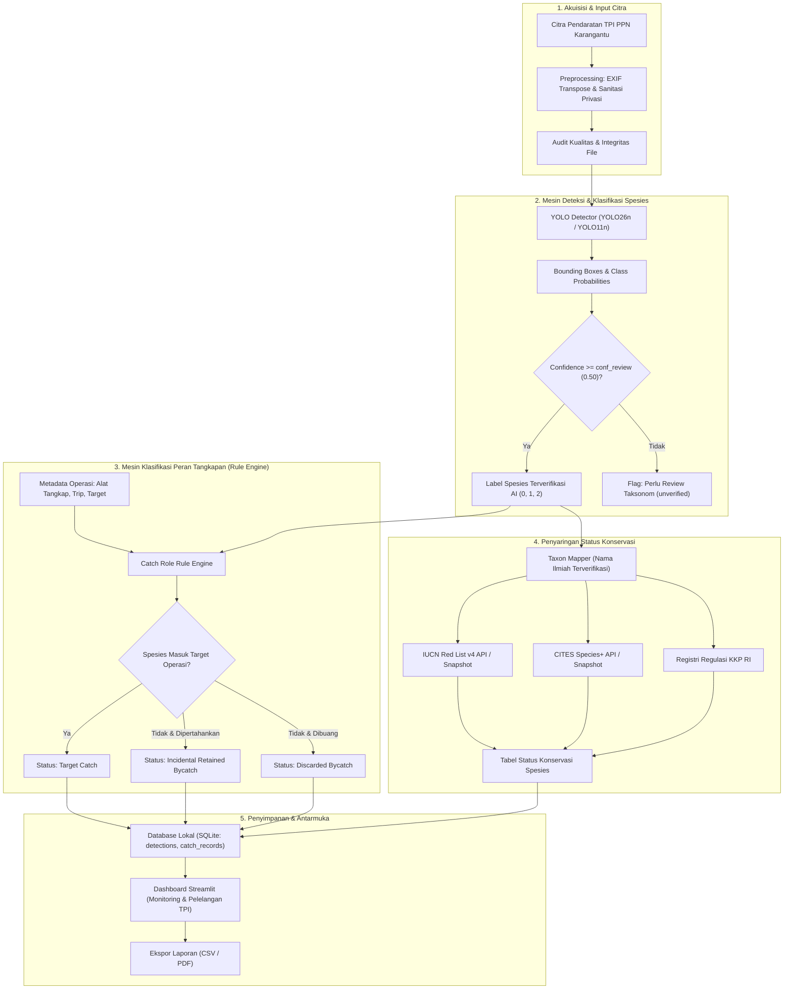

# ARSITEKTUR SISTEM BYCATCH AI (PHASE 6)

## 1. Diagram Alur Kerja End-to-End

---

## 2. Pemisahan Dua Proses Utama (Scientific Axiom)

1. **Species Detection (Computer Vision):**
   * Model YOLO bertugas **murni** mendeteksi morfologi dan memprediksi identitas taksonomi (spesies) dari citra visual:
     * Class 0: `kembung_perempuan` (*Rastrelliger brachysoma*)
     * Class 1: `selar_kuning` (*Selaroides leptolepis*)
     * Class 2: `kuniran` (*Upeneus sulphureus*)
   * Model **tidak pernah** memprediksi status bycatch secara visual karena status bycatch bersifat kontekstual operasional.

2. **Catch Role Classification (Operational Rule Engine):**
   * Klasifikasi peran tangkapan dihitung secara deterministik melalui *rule engine* dengan masukan:
     * Spesies terdeteksi
     * Spesies target operasi penangkapan (misal: target armada jaring insang adalah selar & kembung)
     * Penanganan hasil tangkapan (*retained* vs *discarded*)
   * Kategori hasil: `target`, `incidental_non_target_retained`, `discarded_non_target`, `unverified`.

---

## 3. Hasil Pengukuran Sumber Daya (Empirical Benchmark)

Berdasarkan pengujian riil pada GPU **NVIDIA GeForce RTX 3050 Laptop (4 GB VRAM)** dan RAM sistem (7,26 GB):

| Model | Input Size | Batch | Peak VRAM | Process RAM | Latensi p50 | FPS GPU | Batas 4GB Aman? |
|---|:---:|:---:|:---:|:---:|:---:|:---:|:---:|
| **YOLO11n** | 640 × 640 | 4 | 177.38 MB | 583 MB | 23.97 ms | 164.3 | **AMAN** (VRAM < 5%) |
| **YOLO11n** | 640 × 640 | 2 | 139.95 MB | 726 MB | 21.42 ms | 94.7 | **AMAN** |
| **YOLOv8n** | 640 × 640 | 4 | 173.98 MB | 416 MB | 23.83 ms | 166.1 | **AMAN** |
| **YOLOv8n** | 640 × 640 | 2 | 124.71 MB | 436 MB | 13.21 ms | 146.3 | **AMAN** |

**Kesimpulan Arsitektur:** Arsitektur nano (`yolo11n` / `yolo26n`) dengan resolusi 640x640 dan batch 4 mengonsumsi VRAM di bawah 200 MB saat inferensi, memberikan margin memori yang sangat aman untuk pelatihan lokal.
