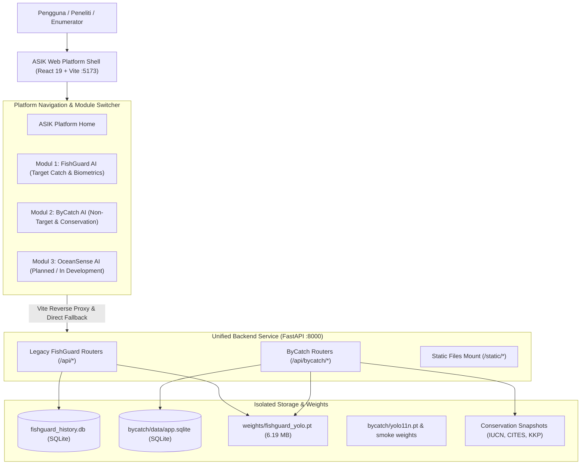

# ASIK PLATFORM — FINAL UNIFIED ARCHITECTURE (CHECKPOINT 2)
**Platform:** ASIK VOL VI Unified Marine Information Platform  
**Institusi:** Program Studi Sistem Informasi Kelautan — UPI Kampus Serang  
**Lokasi Studi:** PPN Karangantu, Teluk Banten  
**Status:** Architecture Decision Approved for Implementation  

---

## 1. System Topology & Module Scope

Berdasarkan arahan pemilik proyek (*Project Owner*), ruang lingkup platform ASIK VOL VI resmi disederhanakan menjadi **3 Modul Utama**:

### 1.1 Modul yang Ditetapkan & Modul yang Diterminasi
1. **Modul 1: FishGuard AI (Aktif & Beroperasi Penuh)**
   * Identifikasi 3 spesies target pendaratan Karangantu (*R. brachysoma*, *S. leptolepis*, *U. sulphureus*).
   * Penghitungan jumlah individu ikan (*fish counting*).
   * Estimasi Total Length (TL) terkalibrasi penanda optik ArUco 50 mm & kompensasi kurvatur rigor mortis.
   * Analisis komposisi tangkapan dan riwayat pendaratan.
2. **Modul 2: ByCatch AI (Aktif & Terintegrasi Penuh)**
   * Deteksi dan analisis hasil tangkapan sampingan (*bycatch analysis*).
   * Mesin klasifikasi peran tangkapan kontekstual (*catch role rule engine* FAO) membedakan target vs incidental retained vs discarded bycatch.
   * Penyaringan status konservasi otoritatif berbasis nama ilmiah valid: IUCN Red List v4, Species+ CITES, dan Regulasi Perlindungan KKP RI (Permen KP No. 1/2021).
   * Pencatatan trip kapal, alat tangkap, dan log tangkapan non-target.
3. **Modul 3: OceanSense AI (Status: Planned / Dalam Pengembangan)**
   * Pemantauan oseanografi dan penginderaan jauh (*remote sensing*) perairan Teluk Banten.
   * Diberi lencana *"Planned / In Development"* secara transparan tanpa fabrikasi data dummy.
4. **Modul CatchForecast AI: DITERMINASI SECARA TOTAL ❌**
   * Sesuai instruksi eksplisit operator, kartu status dan referensi CatchForecast AI dihapus seluruhnya dari antarmuka platform.

---

## 2. Backend Architecture: Unified Multi-Router Pattern

Untuk mencegah kerumitan multi-port dan dependensi ganda, backend mengadopsi pola **Unified Multi-Router** di bawah satu instance FastAPI pada port **8000**:

### 2.1 Router Isolation
1. **FishGuard Routers (Legacy Untouched):**
   * `/api/health`
   * `/api/model/status` & `/api/model/reload`
   * `/api/detect`
   * `/api/measure`
   * `/api/history` & `/api/statistics`
   * *Jaminan:* Seluruh endpoint lama tetap bekerja 100% tanpa perubahan parameter atau schema.
2. **ByCatch Routers (`/api/bycatch/*`):**
   * `/api/bycatch/health` — Status model ByCatch, snapshot konservasi, dan database.
   * `/api/bycatch/detect` — Inferensi deteksi ikan dengan konteks trip nelayan.
   * `/api/bycatch/roles` — Evaluasi peran tangkapan (*catch role engine*) berdasarkan alat tangkap dan penanganan.
   * `/api/bycatch/conservation/{scientific_name}` — Profil status perlindungan IUCN, CITES, dan KKP.
   * `/api/bycatch/records` — Simpan dan ambil riwayat log pendaratan bycatch.

### 2.2 Database Separation & Preservation
* `backend/fishguard_history.db` **TETAP TERISOLASI** dan tidak digabungkan dengan skema ByCatch guna mencegah risiko korupsi data historis.
* ByCatch mengelola SQLite sendiri di `bycatch/data/app.sqlite` menggunakan modul repository bawaannya.

---

## 3. Frontend Architecture: Unified ASIK Platform Shell

Frontend berevolusi dari aplikasi satu modul menjadi **ASIK Platform Shell** di bawah satu project React + Vite (`frontend/`):

### 3.1 Model Navigasi Dua Tingkat (*Two-Level Navigation*)
1. **Tingkat 1: Modul Utama (Platform Switcher)**
   * `asik-home`: Halaman ikhtisar platform ASIK VOL VI (menampilkan 3 kartu modul: FishGuard [Aktif], ByCatch [Aktif], OceanSense [Planned]).
   * `module-fishguard`: Mengaktifkan sub-halaman FishGuard AI.
   * `module-bycatch`: Mengaktifkan sub-halaman ByCatch AI.
   * `module-oceansense`: Halaman informasi status pengembangan OceanSense AI.
   * `about`: Informasi profil SIK UPI Kampus Serang dan pengembang.
2. **Tingkat 2: Sub-Navigasi per Modul**
   * **Sub-halaman FishGuard:** Dashboard, Deteksi AI, Penghitungan, Estimasi Panjang, Riwayat Tangkapan, Info Dataset.
   * **Sub-halaman ByCatch:** Identifikasi & Bycatch Screening, Pencatatan Monitoring Trip, Status Konservasi Otoritatif, Riwayat Log Bycatch.

### 3.2 Desain Sistem & Konsistensi UI
* Mempertahankan tema kelautan gelap modern (*dark marine UI*) dengan palet warna:
  * Slate dasar (`#070d1e` / `#0b132b`)
  * Aksen FishGuard: Cyan (`#06b6d4` / `#38bdf8`)
  * Aksen ByCatch: Amber / Emerald (`#f59e0b` / `#10b981`)
  * Aksen OceanSense: Indigo / Violet (`#818cf8` / `#a855f7`)

---

## 4. Keamanan & Kebijakan Integritas Ilmiah

1. **Batas Ukuran & Format File:** Maksimum 15 MB, format divalidasi MIME (`image/jpeg`, `image/png`, `image/webp`).
2. **Ketahanan Path Traversal:** Validasi nama file dan ID analisis acak (UUID8).
3. **Penyaringan Otomatis Bukan Legalitas:** Setiap keluaran status konservasi (IUCN/CITES/KKP) wajib melampirkan teks disclaimer hukum resmi.
4. **Status Data Latih Jujur:** Pelabelan dataset FishGuard tetap dicantumkan sebagai *sintetis realistis* pendaratan TPI, dan fase sampling fisik Karangantu tetap dilaporkan sebagai *BLOCKED (PENDING SPECIMENS & PERMITS)*.
