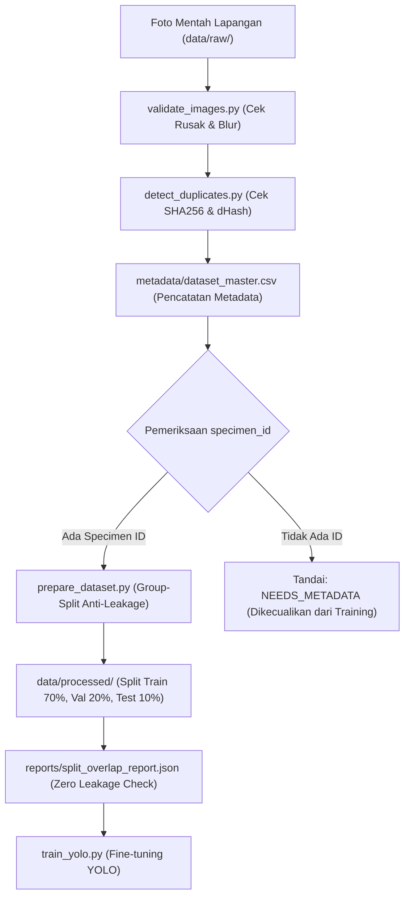

# ARSITEKTUR DAN STRUKTUR PENGELOLAAN DATASET
## FishGuard AI — Dataset Management Architecture & Schema Specification

- **Proyek**: ASIK V — FishGuard AI
- **Modul**: Dataset Pipeline & Metadata Management
- **Versi**: 1.0 (Phase 8 Standard)

---

## 1. Diagram Hierarki Direktori

```
dataset_pipeline/
├── data/
│   ├── raw/                           # Folder penyimpanan citra mentah lapangan (.jpg, .png)
│   └── processed/                     # Folder citra hasil split anti-leakage yang siap dilatih
│       ├── images/
│       │   ├── train/                 # 70% citra spesimen latih
│       │   ├── val/                   # 20% citra spesimen validasi
│       │   └── test/                  # 10% citra spesimen uji terisolasi
│       └── labels/
│           ├── train/                 # Anotasi YOLO .txt untuk train
│           ├── val/                   # Anotasi YOLO .txt untuk val
│           └── test/                  # Anotasi YOLO .txt untuk test
├── metadata/                          # Sistem basis data master dataset (format CSV)
│   ├── dataset_master.csv             # Registri master seluruh citra dan status verifikasi
│   ├── species_reference.csv          # Taksonomi resmi dan ciri pembeda spesies target
│   ├── license_register.csv           # Registri lisensi dataset publik dan etika penggunaan
│   └── ground_truth_measurements.csv  # Pencatatan pengukuran fisik Total Length (TL)
├── annotations/
│   ├── yolo/                          # Master label bounding box YOLO (format normalisasi)
│   └── keypoints/                     # Master label 2-titik keypoint (snout dan caudal tip)
├── reports/                           # Laporan otomatis hasil eksekusi script audit
│   ├── image_quality_report.csv       # Laporan blur, dimensi, dan resolusi tiap citra
│   ├── duplicates_report.csv          # Laporan kandidat duplikasi (SHA-256 dan dHash)
│   ├── dataset_statistics.json        # Ringkasan statistik kuantitatif dataset
│   └── split_overlap_report.json      # Verifikasi zero-leakage antar split
├── sample_calibrated_images/          # Citra spesimen uji teknis terkalibrasi (synthetic test)
├── test_audit_variations/             # Citra uji 6 variasi kondisi untuk audit CV panjang
├── scripts/                           # Perkakas otomasi data pipeline
│   ├── validate_images.py             # Validasi integritas citra dan perhitungan skor blur
│   ├── detect_duplicates.py           # Deteksi duplikat exact & perceptual hash
│   ├── dataset_statistics.py          # Generator statistik dataset faktual
│   ├── prepare_dataset.py             # Group-split berbasis specimen_id
│   ├── train_yolo.py                  # Runner fine-tuning Ultralytics YOLO
│   └── evaluate_metrics.py            # Standar evaluasi mAP@50, MAE cacah, RMSE panjang
└── dataset_config.yaml                # Konfigurasi resmi YOLO (kelas 0: kembung, 1: layang)
```

---

## 2. Spesifikasi Skema Berkas Metadata

### A. `metadata/dataset_master.csv`
Tabel registri induk seluruh file citra yang terdaftar di dalam sistem FishGuard AI:

| Kolom | Tipe Data | Deskripsi & Nilai Standar |
|---|---|---|
| `image_id` | String | ID unik citra (contoh: `IMG-0001`, `IMG-SYNTH-001`) |
| `filename` | String | Nama file berkas fisik di disk (contoh: `TB_20261115_KRN_KMB_001.jpg`) |
| `specimen_id` | String | ID individu spesimen ikan (wajib konsisten antar foto) |
| `species_local` | String | Nama umum lokal (`Kembung`, `Layang`, `Campuran`) |
| `scientific_name` | String | Nama ilmiah taksonomi (`Rastrelliger kanagurta`, `Decapterus macarellus`) |
| `family` | String | Famili taksonomi (`Scombridae`, `Carangidae`) |
| `source_type` | Enum | Sumber: `FIELD_SPECIMEN`, `PUBLIC_DATASET`, `SYNTHETIC_TEST` |
| `source_name` | String | Nama sumber/peneliti (contoh: `FishNet`, `Survei Lapang UPI Serang`) |
| `source_url` | String | Tautan URL sumber atau path lokal |
| `license` | String | Lisensi berkas (`CC BY 4.0`, `Academic Non-Commercial`, dll.) |
| `attribution` | String | Teks sitasi atau kredit fotografer/pemilik |
| `capture_location` | String | Titik geografis (contoh: `TPI Karangantu, Teluk Banten`) |
| `capture_date` | Date | Tanggal pengambilan format `YYYY-MM-DD` |
| `capture_session` | String | ID sesi sampling (contoh: `SESSION_20261115_A`) |
| `camera_device` | String | Tipe perangkat/kamera yang digunakan |
| `image_width` | Integer | Lebar citra dalam piksel |
| `image_height` | Integer | Tinggi citra dalam piksel |
| `annotation_status` | Enum | `ANNOTATED`, `UNANNOTATED`, `IN_PROGRESS` |
| `annotation_type` | Enum | `BBOX_YOLO`, `KEYPOINTS`, `POLYGON`, `NONE` |
| `total_length_cm` | Float | Nilai fisik Total Length (TL) terkalibrasi jika tersedia |
| `length_type` | Enum | `TOTAL_LENGTH`, `FORK_LENGTH`, `STANDARD_LENGTH`, `UNKNOWN` |
| `image_quality` | Enum | Kategori kualitas visual: `HIGH`, `MEDIUM`, `LOW` |
| `verification_status`| Enum | Status validasi taksonomi: `VERIFIED`, `NEEDS_REVIEW`, `UNKNOWN` |
| `split` | Enum | Penetapan split data: `TRAIN`, `VAL`, `TEST`, `EXCLUDED` |
| `notes` | String | Catatan khusus kondisi spesimen atau anomali visual |

---

### B. `metadata/species_reference.csv`
Basis pengetahuan taksonomi resmi untuk dua spesies target dan spesies pembanding yang berpotensi tertukar:

| Kolom | Deskripsi |
|---|---|
| `species_id` | ID unik spesies (contoh: `SP-01`, `SP-02`) |
| `class_id` | ID kelas model YOLO (`0`: kembung, `1`: layang, `-1`: spesies non-target) |
| `scientific_name` | Nama binomial ilmiah resmi (*R. kanagurta*, *D. macarellus*) |
| `genus` | Genus (*Rastrelliger*, *Decapterus*) |
| `family` | Famili (*Scombridae*, *Carangidae*) |
| `diagnostic_features` | Kunci identifikasi visual wajib |
| `confusion_species` | Spesies yang berisiko salah dikenali (*R. brachysoma*, *D. russelli*) |
| `identification_keys` | Karakteristik pembeda utama untuk memverifikasi spesies |
| `verification_status` | `VERIFIED` atau `NEEDS_REVIEW` |

---

### C. `metadata/license_register.csv`
Registri audit lisensi dan ketentuan penggunaan untuk memastikan kepatuhan hak cipta dan etika riset:

- Mencakup status audit untuk **FishNet ICCV 2023**, **DeepFish Zenodo**, **GBIF**, **Wikimedia Commons**, dan **Data Lapang Mandiri UPI Serang**.
- Mengelompokkan status menjadi:
  - `SUITABLE_BENCHMARK`: Cocok untuk benchmarking akademis.
  - `REFERENCE_ONLY`: Hanya sebagai acuan metodologi; domain visual tidak cocok untuk ditraining.
  - `REFERENCE_TAXONOMY`: Rujukan diagnosis morfologi spesimen.
  - `PRIMARY_TARGET`: Data primer yang akan digunakan untuk fine-tuning akhir.

---

### D. `metadata/ground_truth_measurements.csv`
Buku catatan digital pengukuran biometrik fisik ikan (Ground Truth Total Length):

- Mencatat `total_length_cm`, `measuring_instrument` (mistar/ichthyometer), `operator`, `calibration_marker`, dan `repeat_index`.
- Memungkinkan pencatatan pengukuran berulang untuk mengukur galat variabilitas intra/inter-observer.

---

## 3. Alur Kerja Pipeline Data


